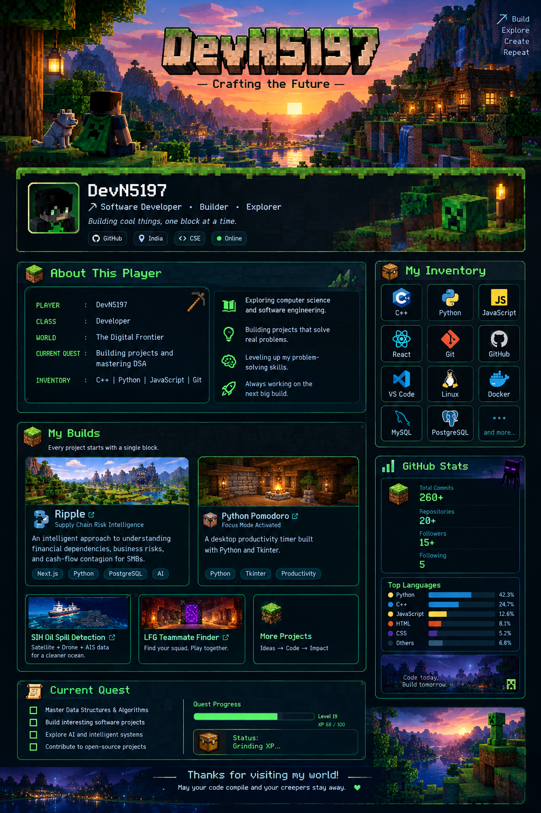

<div align="center">



# 🌿 DevN5197
### ⛏️ Software Developer • Builder • Explorer

*Building cool things, one block at a time.*

[](https://github.com/DevN5197)

</div>

---

## 🌱 About This Player

```text
PLAYER        : DevN5197
CLASS         : Developer
WORLD         : The Digital Frontier
CURRENT QUEST : Building projects and mastering DSA
INVENTORY     : C++ | Python | JavaScript | Git
```

- 🎓 Exploring computer science and software engineering.
- 💻 Building projects that solve real problems.
- 🧠 Leveling up my problem-solving skills.
- 🚀 Always working on the next big build.

## 🧰 My Inventory

<div align="center">


</div>

## 🏗️ My Builds

> Every project starts with a single block.

<!-- TODO: Replace these links with each project's actual repository URL. -->

| Build | Description |
|---|---|
| 🏦 **Ripple** | Supply-chain risk intelligence, financial dependencies, and cash-flow contagion for SMBs. |
| ⏱️ **Python Pomodoro** | A desktop productivity timer built with Python and Tkinter. |
| 🛰️ **Oil Spill Detection** | Satellite, drone, and AIS data for marine pollution detection. |
| 🎮 **LFG Teammate Finder** | A platform for finding teammates and playing together. |

## 📊 Player Statistics

<div align="center">


</div>

## 🟩 Current Quest

- [ ] Master Data Structures & Algorithms
- [ ] Build interesting software projects
- [ ] Explore AI and intelligent systems
- [ ] Contribute to open-source projects

## 🌙 A Living Minecraft World

This animated landscape banner is hosted externally. Replace the URL with a GIF you own or trust if you want a different scene.

<div align="center">


*Code today. Build tomorrow.*

</div>

---

<div align="center">

### 🌄 Thanks for visiting my world!

*May your code compile and your creepers stay away.* 💚


</div>
